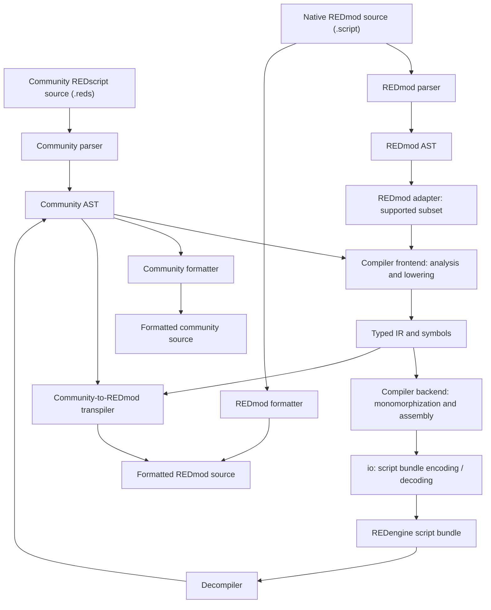

<h3>REDscript</h3>

REDscript is a statically-typed, object-oriented programming language designed for developing scripts for the REDengine, CD Projekt's game engine used in Cyberpunk 2077. If you want to learn more about the language, visit the [official wiki](https://wiki.redmodding.org/redscript).

## Installation

To compile your scripts automatically on game startup, follow the instructions for your platform below.

### Windows
- Download the `redscript-v{version}-windows.zip` archive from the [latest release](https://github.com/jac3km4/redscript/releases/latest).
- Extract it into the main `Cyberpunk 2077` directory.
- When you start the game, successful setup can be confirmed with logs appearing in `Cyberpunk 2077/r6/logs/redscript_rCURRENT.log`.

### MacOS (non-Wine)
- Download the `redscript-v{version}-macos.zip` archive from the [latest release](https://github.com/jac3km4/redscript/releases/latest).
- Extract it into the main `Cyberpunk 2077` directory:
  ```bash
  unzip ~/Downloads/redscript-v*-macos.zip -d "/Applications/Cyberpunk 2077"
  ```
- MacOS automatically quarantines binaries downloaded from the internet so you need to remove them from the quarantine manually:
  ```bash
  xattr -r -d com.apple.quarantine "/Applications/Cyberpunk 2077/engine/tools"
  ```
- The game currently does not compile scripts on startup, so in order to actually compile the scripts you can use the bundled script to start the game:
  ```bash
  "/Applications/Cyberpunk 2077/launch_modded.sh"
  ```

## Editor Support

REDscript provides extensive editor tooling, including a language server and a debugger that integrate with many popular editors such as VSCode, neovim, IntelliJ IDEA, Zed, and Helix. For detailed setup instructions, check out the [REDscript IDE repository](https://github.com/jac3km4/redscript-ide).

## Language Documentation

See the [language guide](docs/README.md) for current community REDscript and native
REDmod support, detailed semantics, known limitations, and future work. Historical
investigations are separated from current contracts; acceptance or bytecode tests
do not establish game-runtime compatibility. CLI `compile` and `lint` are strict
by default; `--runtime-compatible` matches SCC's fatal-error threshold while still
reporting runtime-tolerated diagnostics. It can retain unsafe legacy evaluation
behavior, not guarantee correctness; see the
[diagnostic mode contract](docs/community-language.md#diagnostics-and-tool-boundaries).

## Contributing

See [CONTRIBUTING.md](CONTRIBUTING.md) for validation commands, regression tests, and correctness rules.

## Project Structure

This project includes various tools for working with REDscript, such as a compiler, a decompiler, and a formatter. These are organized as modular Rust crates located in the `crates` directory:

- **`cli`** - Exposes a command-line interface serving as the entry point for all tools in this project.
- **`compiler/frontend`** - Performs static analysis on REDscript syntax, lowering it to an intermediate representation.
- **`compiler/backend`** - Generates bytecode from the intermediate representation and handles monomorphization for generic functions and types.
- **`compiler/api`** - Provides a high-level API for interacting seamlessly with the compiler.
- **`compiler/redmod/adapter`** - Adapts native REDmod syntax to shared semantic analysis.
- **`compiler/redmod/transpiler`** - Transpiles typed community REDscript to REDmod source.
- **`decompiler`** - Decompiles bytecode back into REDscript source code.
- **`io`** - Reads and writes binary files in the native REDengine format.
- **`scc/cli`** - Exposes a CLI that acts as a drop-in replacement for the original compiler made by CD Projekt.
- **`scc/capi`** - Exposes a C API with an interface similar to the `scc` CLI, but with some additional capabilities like source mapping.
- **`scc/core`** - Contains common code used across the scc C API and CLI.
- **`syntax/community/ast`** - Defines the Abstract Syntax Tree (AST) for REDscript.
- **`syntax/community/formatter`** - Formats REDscript source code according to configuration.
- **`syntax/community/parser`** - Parses REDscript source code into the AST.
- **`syntax/redmod/{ast,formatter,parser}`** - Native REDmod syntax trees, printing/formatting and parsing.
- **`dotfile`** - Parses the configuration `.redscript` file.
- **`code-edit`** - Provides source code edits used by tooling and migrations.

### Architecture Overview

Each dialect has its own parser, syntax tree, and formatter. Community REDscript
feeds the compiler frontend directly; the partial REDmod adapter bridges supported
native syntax into the same semantic analysis and lowering pipeline. The frontend
produces typed IR, which the backend monomorphizes and assembles into bytecode.
The `io` crate reads existing script bundles and writes the updated bundles.

The compiler API coordinates community compilation and diagnostics for callers
such as the CLI and SCC integration (`scc/cli` → `scc/capi` → `scc/core`). The
separate [language server](https://github.com/jac3km4/redscript-ide) reuses the
syntax and semantic tooling for editor features.



Arrows show the main data flow, not every crate dependency. The transpiler uses
retained community declarations and typed IR to emit REDmod source; it does not
invoke the official compiler. REDmod analysis and transpilation are partial and
do not guarantee game-runtime compatibility.
